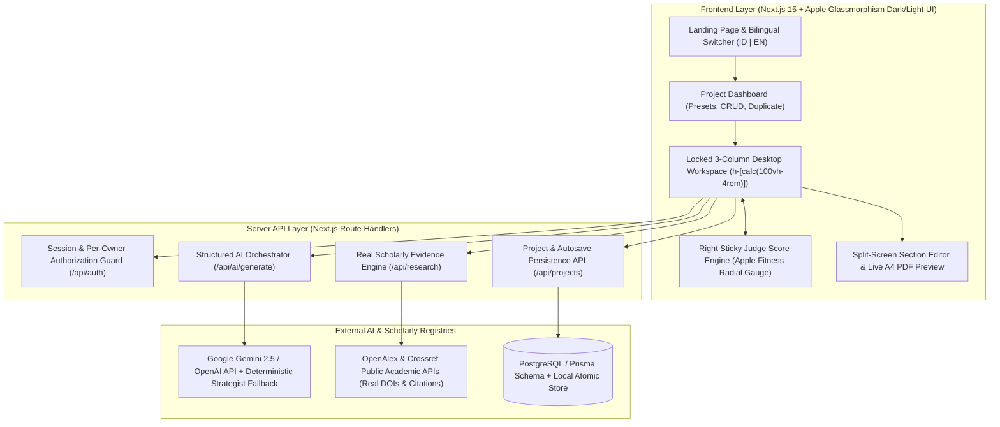

# Hackathon Brief Generator AI (`Ideation-Maker` V1.0)

**From Hackathon Theme to Winning Project Strategy.**  
*Turn your hackathon theme into a validated, technically feasible, judge-aligned project plan.*

**Product Owner:** Christian Immanuel Valerio  
**Product Version:** V1.0  
**Design System:** Apple Liquid Glassmorphism (macOS Dark / visionOS & iOS Daylight Frosted Glass)

---

## 1. Project Overview & Architecture Diagram

**Hackathon Brief Generator AI** is a full-stack AI Product Strategist and Hackathon Planning Workspace built for teams competing in **Microsoft AI Challenge**, **Gemini API Developer Competition**, **AWS Hackathon**, **AI Innovation Competition**, **GEMASTIK**, **PKM-KC**, and **Startup Weekend**.



---

## 2. Features & 10-Step Workflow Summary

Each module separates the **`[User Input Panel]`** (with helper tooltips, character counters, and 1-click preset chips) from the **`[AI Generated Output Panel]`** (with inline editing, per-card regeneration, and copy actions):

1. **Step 1 — Competition Theme Analyzer**: 1-click competition presets (*GEMASTIK*, *PKM-KC*, *Gemini API Competition*, *Microsoft Imagine Cup*) + 7 distinct glass output cards (Theme Breakdown, Industries, Challenges, Tech Opportunities, Problem Areas, Judge Focus, Innovation Directions).
2. **Step 2 — Judge Criteria Engine**: Interactive weight sliders + numeric inputs, live **Total Weight Bar** (turns Emerald at `100%`), and 1-click `"Auto-Balance to 100%"` button.
3. **Step 3 — Problem Discovery Engine**: Guided 6-question wizard + **"Critique My Problem Statement"** mentor diagnostic + canonical formula generator: `"[Target User] experiences [Problem] because [Root Cause], resulting in [Measurable Impact]."`
4. **Step 4 — Evidence Validation Engine**: Smart query generator + live **OpenAlex & Crossref** academic citation lookup with strength badges (`Strong Evidence` in Emerald, `Moderate` in Amber, `Limited` in Rose), clickable DOIs/URLs, and an explicit *Secondary Desk Research vs. Direct User Validation* comparison banner.
5. **Step 5 — Solution Generator**: Side-by-side **3-Column Comparison Matrix** comparing *Option A, B, and C* across Innovation, Feasibility, Impact, and Tech Complexity with a `"Select as Winning Solution"` toggle.
6. **Step 6 — Product Design & MoSCoW Kanban**: Interactive 4-column **MoSCoW Kanban Grid** (`Must Have`, `Should Have`, `Could Have`, `Won't Have Yet`) with priority switcher + **Mermaid.js User Flow Diagram** (with Zoom & Code toggles).
7. **Step 7 — Technical Architecture**: 9-layer architecture configurator + editable **Tech Stack Matrix Table** + **Mermaid.js System Architecture Diagram**.
8. **Step 8 — Development Timeline**: Dynamic sprint duration selector (`24-Hour Hackathon`, `48-Hour Weekend`, `2 Weeks`, `4 Weeks`, `8 Weeks`) that scales milestones, role assignments, and task checklists.
9. **Step 9 — Competition Deliverables**: Interactive checklist split into *Mandatory* vs. *Recommended* deliverables with a circular SVG progress ring, role tags, and custom item builder.
10. **Step 10 — Final Brief & Split-Screen A4 PDF Preview**: Split-screen view with section-by-section editor on the left and a live **A4 Print-Ready PDF Preview** on the right, paired with `Export to PDF`.

---

## 3. Tech Stack & Apple Glassmorphism Design System

- **Framework:** Next.js 15 (App Router), React 19, TypeScript, Tailwind CSS, Lucide Icons
- **Apple Liquid Glass Tokens (`src/app/globals.css`):**
  - **Ambient Mesh Background:** Fixed non-interactive radial blurred orbs (`blur-[140px]`) in Indigo, Electric Violet, and Cyan adapting automatically between **Apple Dark Glass (`#07080E`)** and **Apple Light Frosted Glass (`#F2F4F8`)**.
  - **Surface Primitives:** `.glass-panel`, `.glass-card`, `.glass-input`, `.btn-apple-primary`, and `.btn-glass-secondary`.
- **3-Column Locked Workspace Layout (`h-[calc(100vh-4rem)] overflow-hidden`):**
  - **Context-Aware Topbar:** Displays Breadcrumb (`Dashboard / [Project Name]`), inline editable title badge, autosave pill with timestamp, segmented `ID | EN` toggle, Sun/Moon theme toggle, AI Engine Config modal trigger, Quick Export PDF button, and User Profile pill.
  - **Left Sidebar (`w-72`):** Progress bar, `"Quick Fill Sample Data"` button, and 4-state step indicators (`Completed`, `Active`, `In Progress / Draft`, `Not Started`).
  - **Center Workspace (`flex-1`):** Independent scrollable module canvas + sticky bottom action bar (`Previous Step`, `Save Draft`, `Generate with AI`, `Next Step`).
  - **Right Sticky Panel (`w-80 xl:w-96`):** Permanent **Judge Score Engine** with Apple Fitness-style radial SVG gauge, explicit score math breakdown, weakest area alert, and 3 step-specific score boost tips.

---

## 4. Local Setup & Environment Variables Guide

### Prerequisites
- Node.js 18+ and npm

### Installation
```bash
git clone https://github.com/tiawonkk/Ideation-Maker.git
cd Ideation-Maker
cp .env.example .env.local
npm install
npm run dev
```
Open `http://localhost:3000` in your browser.

### Environment Variables (`.env.example`)
| Variable | Description | Required? |
|---|---|---|
| `DATABASE_URL` | PostgreSQL connection string for Prisma ORM | Optional locally (uses atomic local JSON store out-of-the-box) |
| `GEMINI_API_KEY` | Google Gemini API key for live LLM generation | Optional (configurable in UI modal; falls back to built-in Strategist Engine) |
| `OPENAI_API_KEY` | OpenAI / OpenRouter API key | Optional |

### Testing & Production Build
```bash
npm test
npm run build
```

---

## 5. Current Implementation Status Checklist

- [x] **Phase 1 — Foundation**: Next.js 15 + TypeScript + Apple Dark/Light Glassmorphism Design System, 14-entity Prisma schema, Authentication & Owner Authorization.
- [x] **Phase 2 — Core Workflow (Steps 1–5)**: Theme Analyzer with 1-click presets, Judge Criteria sliders with 100% validation bar, Problem Discovery with AI Critique, Live OpenAlex/Crossref Evidence Validation, and 3-Column Solution Matrix.
- [x] **Phase 3 — Product Planning (Steps 6–9)**: Interactive MoSCoW Kanban, Editable Tech Stack Matrix, Mermaid User Flow & System Diagrams with Zoom/Code toggle, Dynamic Duration Timeline, and Deliverables Progress Ring.
- [x] **Phase 4 — Intelligence & Judge Score Engine**: Context-aware AI Orchestration + Sticky Right Judge Score Engine with Apple Fitness Radial Gauge & explicit math breakdown.
- [x] **Phase 5 — Document Generation (Step 10)**: Split-screen Section Editor + Live A4 Editorial PDF Preview & Export.
- [x] **Phase 6 — Quality Assurance**: Automated Vitest suite (`4/4 passed`) & Next.js production build (`0 errors`).
